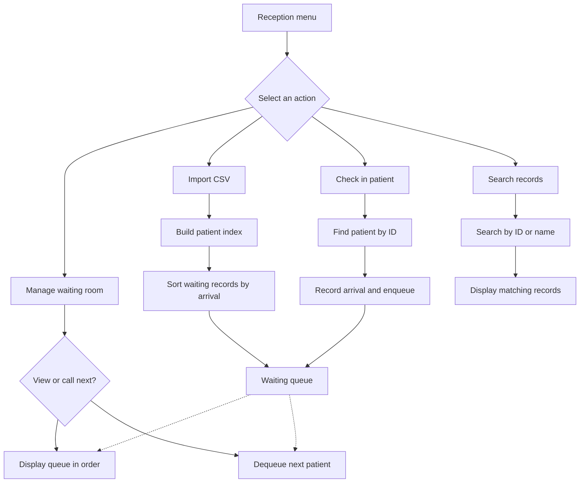
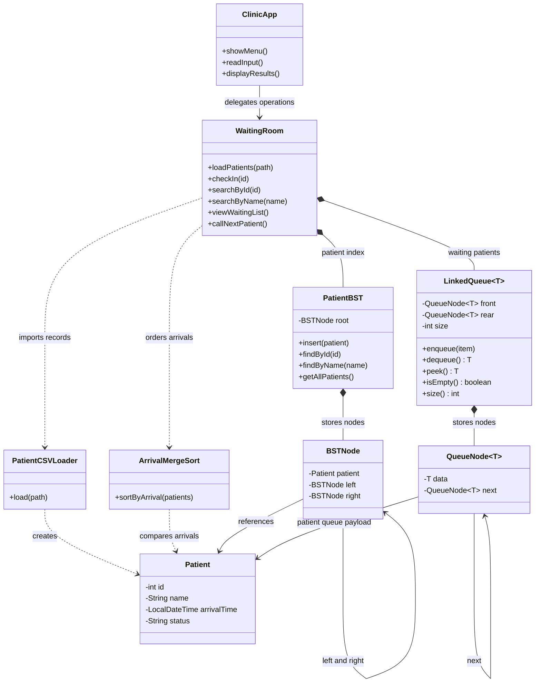

# 🏥 Clinic Waiting Room

**An organized waiting room. A clear patient queue.**

A Java command-line application for managing patient check-in, record lookup, and first-come, first-served visits at a walk-in clinic. Built around a custom linked queue, a binary search tree, and merge sort, it brings patient records and waiting-room operations into one interface.


[Features](#features) · [Workflow](#workflow) · [UML diagram](#uml-diagram) · [Algorithms](#algorithms-and-complexity) · [Interface](#command-line-interface) · [Contributors](#contributors)

---

## Overview

Reception staff need to know who has arrived, who is waiting, and who should be called next. Clinic Waiting Room keeps these tasks connected: patient records support quick lookup, while a separate queue preserves arrival order.

The application uses a dataset of **500+ fictional patient records** for demonstration and testing.

### 👥 Who is it for?

Reception staff at a walk-in clinic who need to:

- ✅ Check in patients as they arrive
- 📋 View the current waiting list
- 🔍 Look up a patient by visit ID or name
- 📣 Call the next patient to the examination room

## Features

| Feature | What reception staff can do |
| :--- | :--- |
| 📂 CSV import | Load patient IDs, names, arrival times, and statuses. |
| 📝 Patient check-in | Locate a patient record and add the patient to the waiting queue. |
| 🔎 Patient search | Find a record by ID or search for matching names. |
| 📋 Waiting list | View patients in their current service order. |
| 📣 Call next patient | Remove the next patient from the front of the queue for service. |
| 🕒 Arrival ordering | Sort imported waiting records by arrival time before building the queue. |

## Workflow



**Service rule:** the earliest waiting arrival is served first. New check-ins join the rear of the queue; calling the next patient removes the front entry. The patient record remains available in the search index after the patient leaves the queue.

## UML diagram

The following conceptual class diagram describes the application's responsibilities and relationships. Class and method labels express the design rather than an exact source-code API.



### How the components fit together

| Component | Responsibility |
| :--- | :--- |
| Command-line interface | Presents menu actions, validates input, and displays results. |
| Waiting-room coordinator | Connects record lookup, check-in, sorting, and queue operations. |
| Patient record | Holds the patient's ID, name, arrival time, and status. |
| Patient BST | Indexes records by ID; traverses records for name searches. |
| Generic linked queue | Maintains FIFO service order with front and rear references. |
| CSV loader | Converts fictional patient data into patient records. |
| Arrival merge sort | Orders imported waiting records chronologically. |

## Algorithms and complexity

Let **n** be the number of indexed patient records and **w** the number of waiting patients.

| Operation | Approach | Time complexity |
| :--- | :--- | :--- |
| Insert one patient | BST keyed by ID | Average **O(log n)**; worst **O(n)** |
| Find a patient by ID | BST lookup | Average **O(log n)**; worst **O(n)** |
| Find patients by name | Traverse the ID-keyed BST | **O(n)** |
| Build the patient index | Repeated BST insertion | Average **O(n log n)**; worst **O(n²)** |
| Sort waiting arrivals | Merge sort | **O(w log w)** |
| Add a waiting patient | Linked queue enqueue | **O(1)** |
| Call the next patient | Linked queue dequeue | **O(1)** |
| View the next patient | Linked queue peek | **O(1)** |
| Display the waiting list | Queue traversal | **O(w)** |

**Why a binary search tree?** An ID-keyed BST supports efficient average-case lookup without scanning every record. An ordinary BST is not automatically balanced: ordered insertions can produce a skewed tree and linear-time searches. Searching by name requires traversal because names are not the tree's ordering key.

**Why a linked queue?** Front and rear references support constant-time insertion and removal. An array list can append in amortized constant time, but removing its first entry requires shifting the remaining elements.

**Why merge sort?** Merge sort provides O(w log w) sorting and can preserve input order for equal arrival times when implemented stably. Its typical auxiliary-space requirement is O(w).

## Patient data

The dataset contains fictional profiles with names from a range of backgrounds. Each record carries four core fields:

| Field | Purpose | Example |
| :--- | :--- | :--- |
| ID | Unique patient lookup key | `1001` |
| Name | Patient display name and name-search value | `Amara Okafor` |
| Arrival time | Chronological ordering for waiting patients | `2026-11-16T09:00:00` |
| Status | Current registration or check-in state | `REGISTERED` |

## Using the application

**Development environment:** Java 21 (JavaSE-21).

1. **Load patient data** from the fictional-record CSV.
2. **Check in an arriving patient** using their ID and record their arrival.
3. **Search by ID or name** to review a patient's record and status.
4. **View the waiting list** to see the current service order.
5. **Call the next patient** to remove the front entry from the waiting queue.
6. **Exit** when finished.

## Command-line interface

Sample menu layout:

```text
=================================
       CLINIC WAITING ROOM
=================================
1. Load CSV
2. Check In Patient
3. Search Patient
4. View Waiting List
5. Call Next Patient
0. Exit
=================================
Enter an option (0-5):
```

## Quality checks

The main correctness checks cover:

- **Patient lookup:** existing and missing IDs, duplicate IDs, and multiple patients sharing a name.
- **FIFO behavior:** patients leave the queue in the same order they entered it.
- **Queue boundaries:** empty queues, single-patient queues, and repeated enqueue/dequeue operations.
- **Arrival sorting:** unordered timestamps, equal arrival times, and already sorted input.
- **CSV and input handling:** missing fields, invalid values, and unsupported menu choices.
- **Integration:** loading, searching, checking in, viewing, and calling patients through the interface.

## Future enhancements

- **Priority-based service:** introduce urgency levels with clearly defined ordering rules.
- **Waiting-time insights:** calculate elapsed waits and summarize delays.

These extensions are separate from the core first-come, first-served workflow.

## Contributors

| Contributor | Focus | Contributions |
| :--- | :--- | :--- |
| [Timothy Nguyen](https://github.com/Laminty) | Core data structures | Generic `LinkedQueue<T>` with front and rear references; adding, viewing, and removing waiting patients; queue operation analysis. |
| [Yu Yin Cheong](https://github.com/YuYinCheong) | Data and search | Patient record design; generation and import of 500+ fictional records; patient lookup and search-method analysis. |
| [Eleanor Frields](https://github.com/Efrields) | User interface and integration | Command-line menu, input validation, and integration of patient data with waiting-room operations. |
| [Khai Nguyen](https://github.com/KhaiNguyen13) | Algorithms and testing | Arrival-time sorting, test-case development, and verification of correctness and operation costs. |
